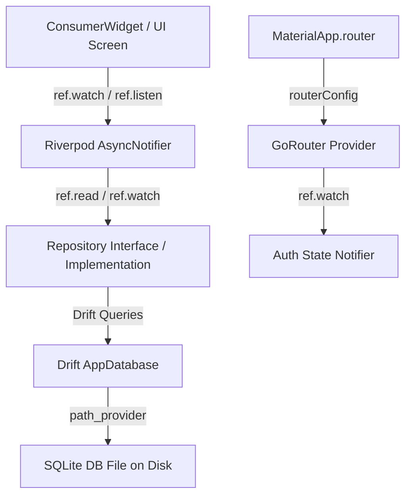

# Flutter Architecture Suite Skill Guide (Riverpod 3.x Stack)

## Overview
This skill provides an end-to-end architecture standard for production Flutter applications. It combines **Riverpod 3.x** (state management), **Drift** (reactive SQLite persistence), **GoRouter** (declarative routing), **PathProvider** (storage directory resolution), and **BuildRunner** (code generation) using a clean **Feature-First Architecture**.

---

## 1. Directory Structure Blueprint

```text
lib/
├── main.dart                          # App entry point (ProviderScope)
├── src/
│   ├── app.dart                       # MaterialApp.router configuration
│   ├── common/                        # Core utilities, extensions, theme
│   │   ├── constants/
│   │   └── widgets/
│   ├── routing/                       # Central GoRouter definition
│   │   └── app_router.dart
│   └── features/                      # Feature modules
│       └── [feature_name]/            # e.g., metro_lines, tickets, user
│           ├── data/                  # Databases, DAOs, DTOs, Repositories
│           │   ├── database/
│           │   │   ├── app_database.dart
│           │   │   └── tables/
│           │   └── repositories/
│           ├── domain/                # Entity models, value objects, logic
│           │   └── models/
│           └── presentation/          # Controllers (AsyncNotifier), UI screens, widgets
│               ├── controllers/
│               └── screens/
```

---

## 2. Integration Architecture Pattern



---

## 3. End-to-End Implementation Template (Riverpod 3.x Stack)

### A. Step 1: Standard `pubspec.yaml`
```yaml
name: metro_line
description: "A production Flutter application using Riverpod, Drift, GoRouter, PathProvider, and BuildRunner."
publish_to: 'none'
version: 1.0.0+1

environment:
  sdk: ^3.3.0

dependencies:
  flutter:
    sdk: flutter
  cupertino_icons: ^1.0.8
  
  # State Management (Latest Riverpod)
  flutter_riverpod: ^3.4.3
  riverpod_annotation: ^4.0.7
  
  # Local Persistence (Latest Drift & Paths)
  drift: ^2.24.0
  sqlite3_flutter_libs: ^0.5.28
  path_provider: ^2.1.6
  path: ^1.9.1
  
  # Routing
  go_router: ^14.8.0

dev_dependencies:
  flutter_test:
    sdk: flutter
  flutter_lints: ^6.0.0
  
  # Code Generation
  build_runner: ^2.4.14
  riverpod_generator: ^4.0.9
  drift_dev: ^2.24.0
  riverpod_lint: ^3.1.9
  custom_lint: ^0.8.1

flutter:
  uses-material-design: true
```

### B. Step 2: Main Entry Point (`lib/main.dart`)
```dart
import 'package:flutter/material.dart';
import 'package:flutter_riverpod/flutter_riverpod.dart';
import 'src/app.dart';

void main() {
  WidgetsFlutterBinding.ensureInitialized();
  runApp(
    const ProviderScope(
      child: MetroLineApp(),
    ),
  );
}
```

### C. Step 3: Application Configuration (`lib/src/app.dart`)
```dart
import 'package:flutter/material.dart';
import 'package:flutter_riverpod/flutter_riverpod.dart';
import 'routing/app_router.dart';

class MetroLineApp extends ConsumerWidget {
  const MetroLineApp({super.key});

  @override
  Widget build(BuildContext context, WidgetRef ref) {
    final router = ref.watch(goRouterProvider);

    return MaterialApp.router(
      title: 'Metro Line',
      debugShowCheckedModeBanner: false,
      theme: ThemeData(
        useMaterial3: true,
        colorScheme: ColorScheme.fromSeed(seedColor: Colors.deepPurple),
      ),
      routerConfig: router,
    );
  }
}
```

---

## 4. Code Generation & Execution Workflow

To run full project generation:
```bash
dart run build_runner build --delete-conflicting-outputs
```

To run active watcher during dev:
```bash
dart run build_runner watch --delete-conflicting-outputs
```

---

## 5. Summary Checklist for Developers

- [ ] Features organized under `lib/src/features/<feature>/`
- [ ] Database storage paths resolved dynamically via `getApplicationDocumentsDirectory()` from `path_provider`
- [ ] Riverpod 3.x providers created with `@riverpod` annotations and generated via `build_runner`
- [ ] Controllers inheriting from `_$Notifier` or `_$AsyncNotifier` using `AsyncValue.guard()`
- [ ] Declarative routing configured via `GoRouter` with Riverpod 3.x integration
- [ ] All database queries wrapped in reactive `Stream`s or type-safe `Future`s
